# Mobile Robot Components — Fusion 360 CAD Models

3D models of the 11 electronic and mechanical components of a small two-wheeled mobile robot, made in **Autodesk Fusion 360**. Each part is available as an editable Fusion 360 file (`.f3d`) and as an **STL** mesh.

> 💡 **Click any `.stl` file to rotate the model in your browser.** GitHub has a built-in 3D viewer.

<p align="center">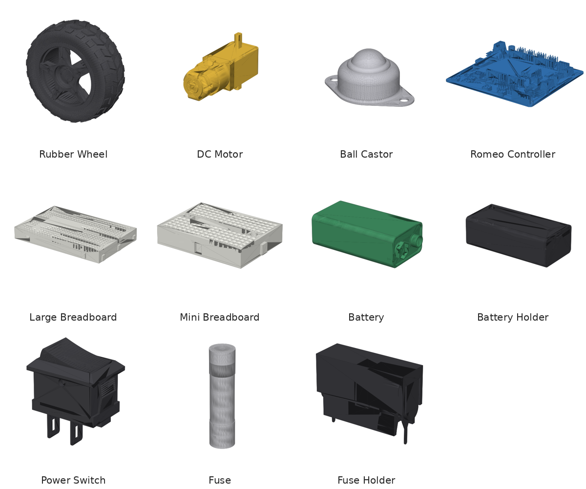</p>

## Parts

| # | Part | Role in the robot | Size (mm) | Preview | Files |
|:-:|---|---|---|:-:|---|
| 1 | Rubber wheel | Drive wheel | Ø74 × 27.5 | 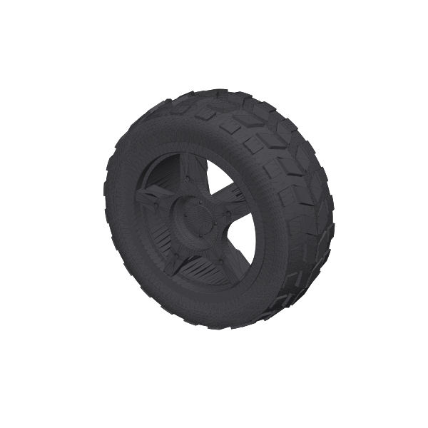 | [STL](parts/01-rubber-wheel/rubber_wheel.stl) · [F3D](parts/01-rubber-wheel/rubber_wheel.f3d) |
| 2 | DC gear motor | Drives a wheel | 70 × 41 × 22.4 | 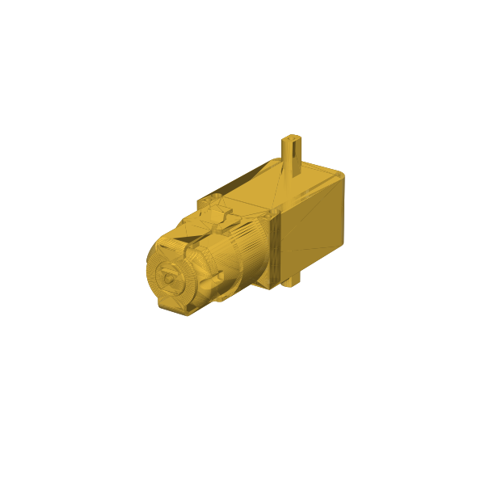 | [STL](parts/02-dc-motor/dc_motor.stl) · [F3D](parts/02-dc-motor/dc_motor.f3d) |
| 3 | Mini breadboard | Small prototyping area | 47.5 × 35.5 × 9 | 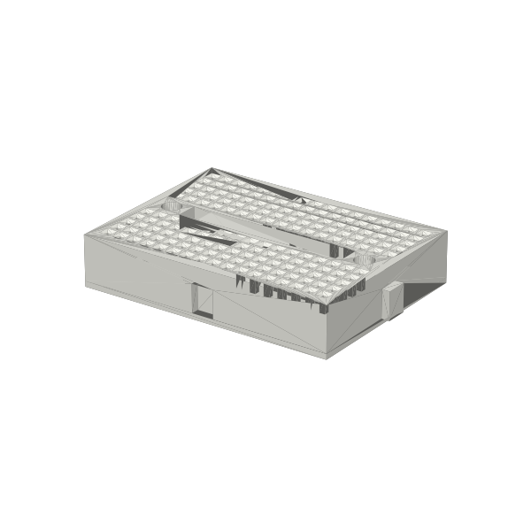 | [STL](parts/03-mini-breadboard/mini_breadboard.stl) · [F3D](parts/03-mini-breadboard/mini_breadboard.f3d) |
| 4 | Large breadboard | Main prototyping area | 83 × 55.5 × 10 | 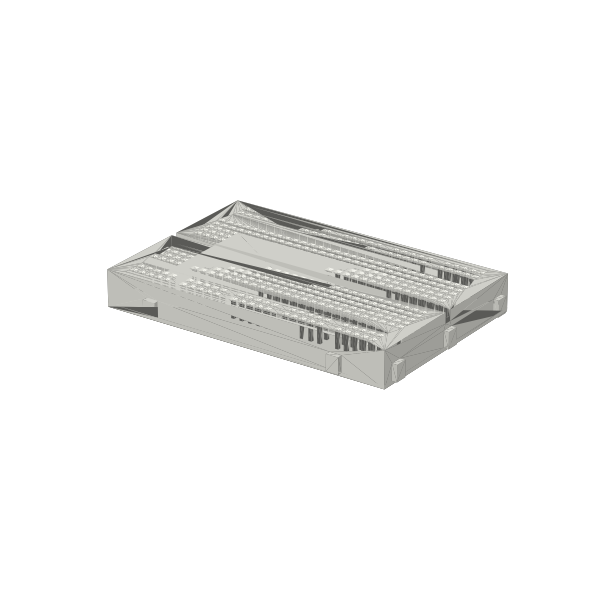 | [STL](parts/04-large-breadboard/large_breadboard.stl) · [F3D](parts/04-large-breadboard/large_breadboard.f3d) |
| 5 | Rocker power switch | Main power on/off | 14.5 × 10 × 18.8 | 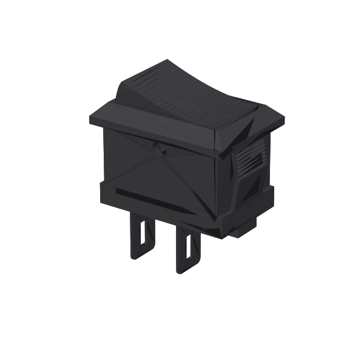 | [STL](parts/05-power-switch/power_switch.stl) · [F3D](parts/05-power-switch/power_switch.f3d) |
| 6 | Romeo controller board | Microcontroller with built-in motor driver | 90.3 × 84.5 × 12.3 | 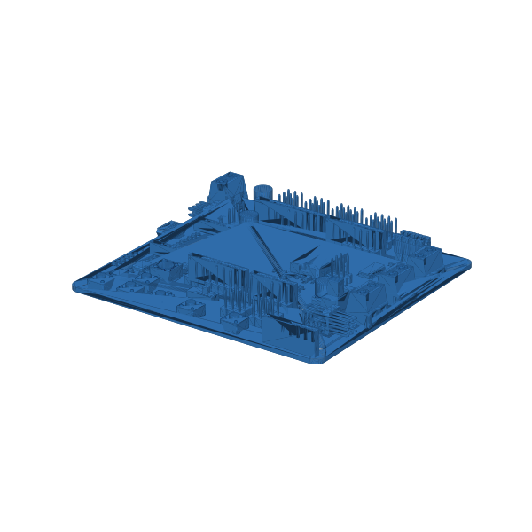 | [STL](parts/06-romeo/romeo.stl) · [F3D](parts/06-romeo/romeo.f3d) |
| 7 | Cartridge fuse | Overcurrent protection | Ø5 × 20 | 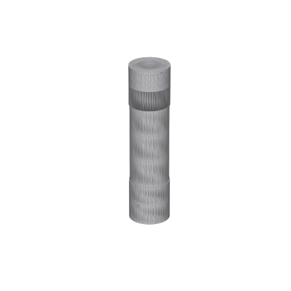 | [STL](parts/07-fuse/fuse.stl) · [F3D](parts/07-fuse/fuse.f3d) |
| 8 | Fuse holder | Holds the fuse | 26.5 × 9.5 × 20.5 | 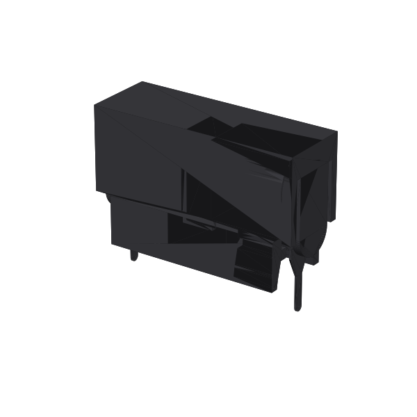 | [STL](parts/08-fuse-holder/fuse_holder.stl) · [F3D](parts/08-fuse-holder/fuse_holder.f3d) |
| 9 | 9 V battery | Power source | 48.7 × 24.5 × 15.5 | 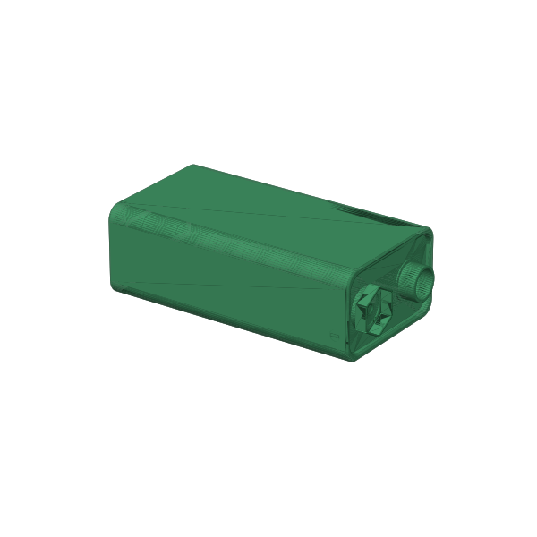 | [STL](parts/09-battery/battery.stl) · [F3D](parts/09-battery/battery.f3d) |
| 10 | Battery holder | Holds the battery | 72 × 32 × 21.2 | 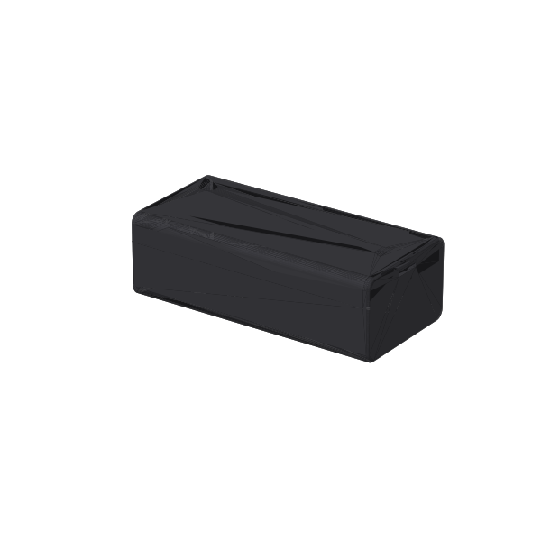 | [STL](parts/10-battery-holder/battery_holder.stl) · [F3D](parts/10-battery-holder/battery_holder.f3d) |
| 11 | Ball castor | Free-rolling third support point | 50 × 32 × 21.8 | 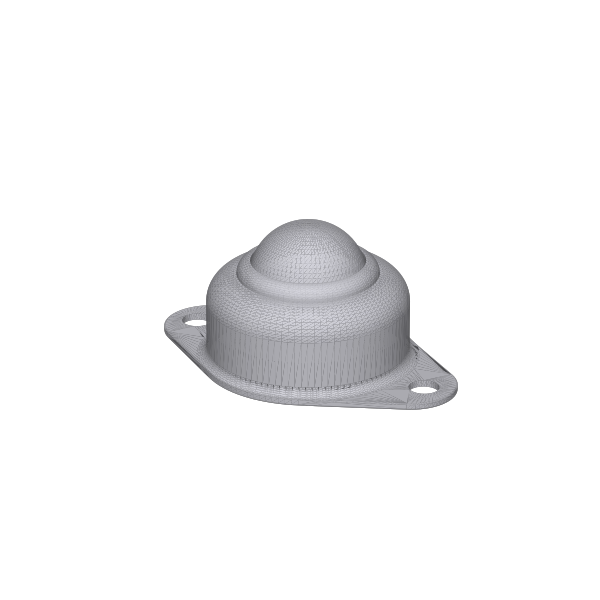 | [STL](parts/11-ball-castor/ball_castor.stl) · [F3D](parts/11-ball-castor/ball_castor.f3d) |

The sizes are the bounding boxes of the STL meshes, in millimetres.

## How the parts fit together

Together, the parts make up a standard **differential-drive** layout. Two DC gear motors each turn a rubber wheel, and a ball castor provides the third point of contact. The **Romeo** board, an Arduino-compatible controller with a built-in dual motor driver, controls the motors. The 9 V battery in its holder powers the robot through a fuse and rocker switch, and the two breadboards give room for sensors and extra circuits.

## Using the files

- **`.f3d`:** open in Autodesk Fusion 360 (**File → Open → Open from my computer**) to see the full editable design history.
- **`.stl`:** view directly on GitHub, or import into any slicer or CAD tool (Cura, PrusaSlicer, Blender, FreeCAD) for 3D printing or to place the part in your own assembly.

## Repository layout
```
parts/
├── 01-rubber-wheel/
│   ├── rubber_wheel.f3d      # editable Fusion 360 design
│   ├── rubber_wheel.stl      # mesh (viewable on GitHub)
│   └── preview.png
├── 02-dc-motor/
└── …                         # one folder per part, same structure
media/gallery.png
```

## Context

Modelled as part of my BEng Robotics and Artificial Intelligence studies (University of Hertfordshire, delivered at PSB Academy, Singapore).

## Author

**Steve Flinston** ([@steveerobotclubsmt-create](https://github.com/steveerobotclubsmt-create))
